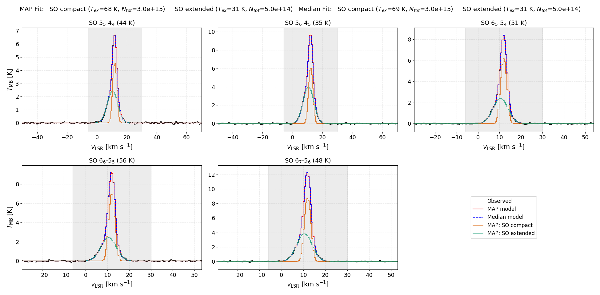
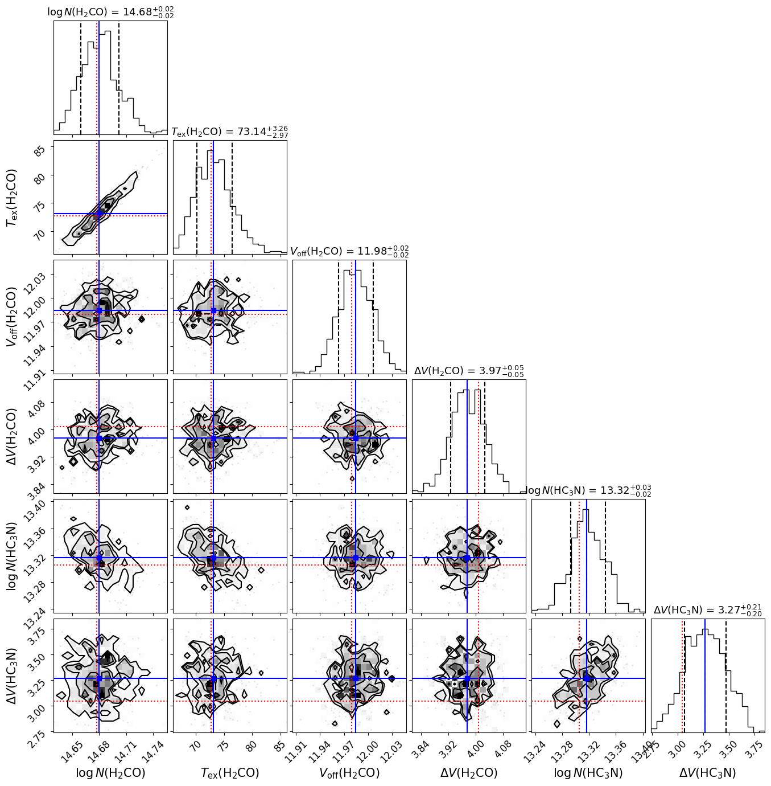

# mcWEEDS

[](https://doi.org/10.5281/zenodo.24400869)

MCMC fitting of molecular line spectra under LTE, using the
[WEEDS](https://www.iram.fr/IRAMFR/GILDAS/) extension of GILDAS/CLASS as the
radiative-transfer model and [emcee](https://emcee.readthedocs.io) as the sampler.

At every MCMC step, WEEDS (`MODSOURCE`) computes a synthetic LTE spectrum for
1 to 3 emission components, and the model is compared with the observation inside
user-defined line windows. The noise model includes correlated channels.

**Main features**

- **One spectrum or many.** Fit one spectrum that contains several lines (e.g. a
  CH3CN K-ladder), or a set of separate spectra (e.g. single-line cut-outs from
  several spectral windows), all with the same physical parameters.
- **Any spectrum CLASS can read.** GILDAS VLM cubes (the centre pixel by default) and
  CLASS spectra files (`.30m`, `.cla`, ...), mixed freely. A `select:` block chooses
  the spectrum inside a file (offset, observation number, source, line, telescope).
- **Flexible parameters.** Column density, excitation temperature, source size,
  velocity and line width of each component can be free (uniform prior), fixed,
  or tied to another component. Several components may share one catalogue species
  (e.g. a compact and an extended component).
- **Correlated noise.** The noise autocorrelation is measured in line-free windows
  (or given in the config) and used through a full Toeplitz covariance
  (`chi_sq_method: whitened`). `standard` and `integrated` χ² are also available.
- **CDMS or JPL**, online or from a local catalogue copy. CDMS species names with
  spaces or commas (`'SO, v=0'`) are handled.
- **Diagnostics and output.** Autocorrelation time, burn-in and thinning; median ± 1σ
  and MAP values; spectrum and corner plots; chains saved for re-analysis; a
  plain-text summary.
- **Tools** to compute a single model without MCMC (with the line opacities reported
  by WEEDS), to plot the observed lines, to make synthetic observations with known
  parameters, and to make or check a local catalogue.

## Requirements

**GILDAS (CLASS with WEEDS).** mcWEEDS runs CLASS as a separate program (`class -nw`) and
does not need the GILDAS Python interface (pyclass), so it works with any Python environment.
WEEDS is part of CLASS in the standard GILDAS distribution. Install GILDAS following the
[installation guide](https://www.iram.fr/IRAMFR/GILDAS/install.html) (from source on Linux,
or with MacPorts on macOS).

GILDAS must be set up in every shell from which you run mcWEEDS (source the environment
script created at installation, or use your system's command for it, e.g. in `~/.bashrc`).
To check:

```bash
which class        # prints the path of the class program if GILDAS is set up in this shell
```

**Python ≥ 3.8** with the packages in `requirements.txt`:

```bash
pip install -r requirements.txt
```

**Tested with** GILDAS nov25a on Fedora 40 (x86_64, gfortran), Python 3.10.20, numpy 2.2.6,
scipy 1.15.3, matplotlib 3.10.9, emcee 3.1.6, corner 2.3.0 and PyYAML 6.0.3.

## Quick start

```bash
git clone https://github.com/ramlalunni/mcWEEDS.git
cd mcWEEDS
python tools/check_examples.py            # check the installation (see below)
python run_mcweeds.py examples/h2co_hc3n_single_spectrum.yaml
```

Run everything from the mcWEEDS folder: paths in the configs (spectra, catalogue,
`init_model`) are relative to the folder you run from. Put the spectra you want to
model, and the local catalogue, in `data/` (any path works, but git ignores everything
in `data/` except the example files, so your data are never committed by accident).

### Check your installation

```bash
python tools/check_examples.py
```

computes the WEEDS model at the true parameters on the example data and compares it
with the data channel by channel. Because the example data were made with fixed random
seeds, the result is exactly known: the residuals must equal the stored noise, and the
χ² per fitted channel (χ²/N) must be 0.853 (example 1) and 0.995 (example 2), close to 1
as expected when the model matches the data up to the noise. The check ends with `ALL OK` if
GILDAS/CLASS/WEEDS and mcWEEDS work together as intended. The examples use
`data/cdms_examples.db`, a small extract of the CDMS catalogue with only the three
example species, so they run without a catalogue download; for your own data, make a
local copy as described in "Local catalogue".

### Output files

A run writes the following to `MCMC_<run_name>/` (or `output_dir`):

| File | Contents |
|---|---|
| `mcmc_best_fit_spectrum.png` | observed spectrum (or one panel per spectrum) with the MAP and median models and, for several components, each component alone |
| `mcmc_corner.png` | corner plot of the free parameters (median in blue, MAP dotted red) |
| `mcmc_chains.npz` | full chain, log-probabilities, and flattened samples after burn-in and thinning |
| `fit_summary.txt` | median, ±1σ and MAP of every free parameter; fixed and shared parameters |
| `best_fit_spectrum.txt` | ASCII table, one row per channel: frequency, velocity (if `rest_freq`), observed, MAP and median models, MAP model of each component, channels used in the fit; `best_fit_spectrum_<i>.txt` for several spectra |
| `map_model.yaml`, `median_model.yaml` | MAP and median parameters as model files, for `tools/single_model.py` or `init_model` |
| `config_used.yaml` | copy of the configuration of the run |
| `failed_models.log` | CLASS runs that failed or timed out (only if there were any) |
| `init*.class`, `obs_*.txt`, `temp_mdl_files/` | CLASS working files: the macro that extracted each spectrum and its output, and the per-model files (deleted after each model). Useful for debugging; can be deleted |

To make your own plots, reload the chains and the best-fit spectra:

```python
import numpy as np
d = np.load("MCMC_<run_name>/mcmc_chains.npz")
d["flat_samples"], d["param_names"]          # log10(ntot) for column densities
s = np.genfromtxt("MCMC_<run_name>/best_fit_spectrum.txt", names=True)
s["freq_MHz"], s["T_obs"], s["T_MAP"], s["T_median"]
```

## Examples

The example data in `data/` (`synth_*.30m`) are **synthetic observations of a fictitious
source**: WEEDS LTE models with known parameters plus correlated Gaussian noise (rms
50 mK, correlation 0.39 between neighbouring channels, 0.488 MHz channels), made with
`tools/make_synthetic_spectra.py` from the example configs themselves (see "Making
synthetic data" below). A good fit recovers the true values.

| Config | Input structure | What else it shows |
|---|---|---|
| `examples/h2co_hc3n_single_spectrum.yaml` | **one spectrum with several lines** (`spectrum_file`, windows in MHz): H2CO (3 lines) + HC3N 24–23 at 218.1–218.9 GHz | two molecules; parameters shared between molecules (`shared_with`); RMS and noise correlation estimated from the noise windows |
| `examples/so_2comp_multi_spectrum.yaml` | **several spectra, one file per line** (`spectra:`, windows in km/s): 5 SO lines at 215–262 GHz | two components of the same species (compact + extended); fixed and free parameters; fixed RMS and noise correlation; walkers started around a model |
| `examples/vlm_cube_template.yaml` | **VLM cubes** (no data included) | choosing the pixel (`select: offset`); mixing VLM cubes and CLASS files |

True parameters (also in `examples/truth_*.yaml`):

| Component | N [cm⁻²] | T_ex [K] | θ_s [″] | v_off [km/s] | Δv [km/s] |
|---|---|---|---|---|---|
| H2CO | 5.0 × 10¹⁴ | 75 | 1.5 | 12.0 | 4.0 |
| HC3N | 2.0 × 10¹³ | 75 (= H2CO) | 1.5 | 12.0 (= H2CO) | 3.5 |
| SO compact | 3.0 × 10¹⁵ | 70 | 0.5 | 12.0 | 3.0 |
| SO extended | 5.0 × 10¹⁴ | 30 | 4.0 | 10.5 | 8.0 |

(N: total column density; T_ex: excitation temperature; θ_s: source size; v_off:
velocity; Δv: line width, FWHM.) In the examples the source sizes are fixed at their
true values; the other parameters are fitted.

### Example output

Both figures are from short runs of the examples with the walkers started around the true
values (500 steps for SO, 400 for H2CO + HC3N); all fitted values are within 1.5σ of the
true ones. A run with the example configs as they are gives the same kind of figures.



*`mcmc_best_fit_spectrum.png` of the SO example: the five observed spectra (black), the
MAP model (red), the median model (blue dashed) and the two components of the MAP model
(compact and extended). Grey: the line windows (the fitted channels).*



*`mcmc_corner.png` of the H2CO + HC3N example: the posterior of the six free parameters,
with the median (blue) and the MAP values (red dotted); the titles give the median and
the 16th–84th percentile range. The column density and the excitation temperature of
H2CO are correlated.*

## Configuration

Every option is commented in the example configs. The main blocks:

### Spectra

**One spectrum** containing several lines:

```yaml
spectrum_file: data/my_spectrum.vlm
line_windows:  [[218206.5, 218220.5], [218459.9, 218473.9]]   # MHz, channels used in the fit
noise_windows: [[218110.0, 218195.0], [218340.0, 218445.0]]   # MHz, line-free channels
```

**Several spectra**, each with its own windows, in MHz or in km/s relative to
`rest_freq` (radio convention):

```yaml
spectra:
  - file: data/line1.vlm
    label: 'SO $5_5$-$4_4$'                  # panel title
    rest_freq: 215220.653                    # MHz; also gives the velocity axis of the panel
    line_windows_kms:  [[-6.0, 30.0]]
    noise_windows_kms: [[-45.0, -15.0], [40.0, 65.0]]
  - file: data/line2.30m                     # a CLASS spectra file works the same way
    rest_freq: 258255.826
    line_windows_kms:  [[-6.0, 30.0]]
    noise_windows_kms: [[-45.0, -15.0]]
    telescope_size: 250.0                    # optional, per spectrum
    plot_range: [258220, 258280]             # optional, MHz
```

The same WEEDS model is evaluated on every spectrum in one CLASS run, and the χ²
of all spectra are summed. The RMS is estimated per spectrum (or fixed with
`noise_rms`); the noise correlation is pooled over spectra with the same channel
width (or fixed with `noise_acf`).

### Which spectrum of a file (`select`)

Any file CLASS opens with `FILE IN` can be used. By default the spectrum at offset
(0, 0) is taken (the centre pixel of a VLM cube) and, if several match, the first one.
This can be changed globally or per spectrum:

```yaml
select:                  # top level: default for all spectra
  offset: [0, 0]         # arcsec; or "any"
  match: 0.2             # offset tolerance, arcsec (CLASS SET MATCH)
spectra:
  - file: data/obs.30m
    select: {offset: any, number: 12}         # observation number 12
  - file: data/cube.vlm
    select: {offset: [1.5, 0]}                # another pixel of the cube
```

Other keys: `source`, `line`, `telescope` (names as in the CLASS header). The
selection becomes CLASS `FIND` options, and the same selection is used to extract the
data and to compute every model. mcWEEDS reports how many spectra matched, and
stops with a clear message if none did.

To see the spectra a file contains (number, source, line, telescope, offsets), use
`file in <file>`, `find`, `list` in CLASS. mcWEEDS fits one spectrum per entry and
does not average: to fit the average of several scans, average them in CLASS first
(`find` with your selection, `average`, `write` to a new file).

### Using VLM cubes

A VLM cube is a GILDAS cube stored with the spectral axis first, which CLASS opens
directly with `FILE IN`: every pixel is a spectrum. Use it anywhere a CLASS file can be
used (as `spectrum_file` or in `spectra:`), alone or mixed with CLASS files; see
`examples/vlm_cube_template.yaml`.

The pixel is chosen with `select: offset`. Each pixel spectrum carries its offset
(Δx, Δy) in arcsec from the projection centre of the cube (the reference position in the
cube header, usually the phase/map centre; Δx positive to the east):

```yaml
select: {offset: [0, 0]}           # the pixel at the projection centre (default)
select: {offset: [0.8, -0.4]}      # the pixel 0.8" east and 0.4" south of it
select: {offset: [0.8, -0.4], match: 0.05}   # tolerance for small (here 0.2") pixels
```

- The offset must be that of an actual pixel, i.e. a multiple of the pixel size from
  the centre. To list the offsets in CLASS: `file in mycube.vlm`, `find`, `list`.
- `match` (default 0.2″) must be smaller than half the pixel size, so that exactly one
  pixel matches. mcWEEDS warns if several spectra match (the first is then used) and
  stops if none does.
- If the source is not at the projection centre, use the offset of the pixel at the
  source position. Small cut-outs centred on the source (e.g. 3 × 3 pixels) keep the
  files small and make `[0, 0]` the source pixel.

### Components and parameters

```yaml
molecules:                     # 1 to 3 emission components
  - name: SO_c                 # unique name
    species: 'SO, v=0'         # catalogue entry (default: name); CDMS name, JPL: SO
    label: 'SO compact'        # used in plots
    ntot:  [1.0e14, 1.0e18]    # cm^-2, free (fitted as log10)
    tex:   [50.0, 400.0]       # K
    source_size: {fixed: 0.5}  # arcsec
    v_off: 12.0                # km/s, fixed (plain number)
    width: [1.0, 6.0]          # km/s (FWHM), free
```

Each parameter is `[min, max]` (free, uniform prior), a value or `{fixed: value}`,
or `{shared_with: OTHER}` (equal to the same parameter of another component). WEEDS
adds the components (no absorption of one by another). If you fit `source_size`,
expect it to be degenerate with `ntot` when the source is unresolved and the lines
are optically thin.

### Likelihood

- `chi_sq_method: whitened` (default): full noise covariance from the noise
  autocorrelation (ACF), for correlated channels
- `standard`: independent channels
- `integrated`: integrated area per line window (its error includes the noise ACF)
- `noise_acf: [1.0, 0.39]` (optional): fixed ACF instead of the estimate from the
  noise windows, e.g. measured on a larger noise sample
- `noise_rms: 0.03` (optional, K): fixed RMS noise instead of the estimate from the
  noise windows; at the top level for all spectra, or per spectrum. Recommended for
  short cut-outs: with only ~10 noise channels the measured RMS is uncertain by
  ~20–25 %, which changes the weight of that spectrum in the fit (χ² ∝ 1/RMS²) and
  the error bars. With both `noise_rms` and `noise_acf` given, the noise windows may
  be omitted.

### MCMC

```yaml
mcmc:
  n_walkers: 32
  n_steps: 3000
  n_threads: 32              # parallel CLASS processes
  init_model: examples/model_so_2comp.yaml   # optional: start around a model ...
  init_scatter: 0.05         # ... in a ball of ± 5 % of each prior range
```

Without `init_model` the walkers start uniformly over the priors.

## Tools

```bash
# One WEEDS model, no MCMC: plot, chi-square per spectrum, model spectra (.npz) and the
# WEEDS MODSOURCE /VERBOSE output with the line-centre opacity of every line
python tools/single_model.py examples/so_2comp_multi_spectrum.yaml examples/model_so_2comp.yaml

# Observed spectra of a config (frequency and velocity axes, line markers), no model.
# Only the spectra are needed: molecules and windows may still be missing, so this can be
# run on a new source first (minimal config in the docstring of the tool)
python tools/plot_observed_lines.py examples/so_2comp_multi_spectrum.yaml

# Synthetic observations with known parameters (see "Making synthetic data")
python tools/make_synthetic_spectra.py examples/so_2comp_multi_spectrum.yaml examples/truth_so_2comp.yaml --rms 0.05 --seed 2

# Installation check on the example data (see "Check your installation")
python tools/check_examples.py

# Compare the local catalogue with the online one
python tools/check_catalog.py examples/h2co_hc3n_single_spectrum.yaml cdms 3
```

A model file has one entry per component, with all five parameters:

```yaml
SO_c: {ntot: 5.0e15, tex: 100.0, source_size: 0.5, v_off: 12.5, width: 3.5}
SO_e: {ntot: 3.0e14, tex: 40.0,  source_size: 4.0, v_off: 10.0, width: 7.0}
```

## Making synthetic data

`tools/make_synthetic_spectra.py` computes a WEEDS model with known parameters (a
"truth" file, same format as a model file) on the spectra of a config, adds Gaussian
noise with a given RMS and neighbouring-channel correlation, and writes CLASS files.
Useful to test whether a setup (lines, windows, noise) can recover the parameters you
need, e.g. before observing, and how the example data were made.

- **Grid mode:** give each spectrum a `grid: [fmin, fmax, channel width]` (MHz) in the
  config (for one spectrum: next to `spectrum_file`). The spectra are created from
  scratch and written to the config's own `file:` paths, so the same config is then fitted:
  ```bash
  python tools/make_synthetic_spectra.py examples/so_2comp_multi_spectrum.yaml \
         examples/truth_so_2comp.yaml --rms 0.05 --seed 2
  ```
- **Template mode:** without `grid:`, the existing spectra of the config give the
  frequency axes (and headers); the output goes to a folder you name:
  ```bash
  python tools/make_synthetic_spectra.py my_config.yaml my_truth.yaml data/ --rms 0.03
  ```

Every file is read back and checked; the noise-free models and the noise are saved in
`<truth name>_spectra.npz`, next to a copy of the truth file.

## Local catalogue (recommended)

`catalog: cdms` (or `jpl`) queries the online catalogue for every model. A local copy
gives the same models and is much faster. Create it once with CLASS, covering all
your spectra (edit `tools/make_catalog.class`):

```
use in cdms
use out data/cdms_210_265_GHz.db
select /freq 210000 265000
insert
exit
```

and set `catalog: data/cdms_210_265_GHz.db` in your config. (The examples use
`data/cdms_examples.db`, an extract of such a copy with only H2CO, `'HC3N, v=0'` and
`'SO, v=0'`.)

- For JPL, use `use in jpl` the same way.
- Species names must be those of the catalogue: e.g. `SO` in JPL but `'SO, v=0'` in
  CDMS. To list the names in a local copy:
  `python -c "import sqlite3; print(sqlite3.connect('data/cdms_210_265_GHz.db').execute('select distinct species from line').fetchall())"`

## Documentation

[`docs/methods.md`](docs/methods.md) explains every step the code performs:
priors, noise estimation, correlated-noise whitening (ACF, Toeplitz covariance,
Cholesky), the likelihood, the emcee sampler, convergence diagnostics and the
reported results, with the assumptions, limitations and references.

## Code layout

```
run_mcweeds.py           entry point
mcweeds/config.py        reads the YAML: spectra, selection, free/fixed/shared parameters
mcweeds/observation.py   extracts the spectra, estimates the noise, builds the whitening matrices
mcweeds/class_model.py   writes the WEEDS model file and runs CLASS for one model (all spectra)
mcweeds/fitting.py       prior, likelihood, emcee run, diagnostics, chains and summary
mcweeds/plotting.py      spectrum and corner plots
tools/                   single model, observed-line plots, synthetic data, installation check,
                         catalogue tools
examples/                example configurations, model files and the true parameters of the synthetic data
data/                    your spectra and the local catalogue; contains the example spectra
                         (synth_*.30m), their noise-free models and noise
                         (truth_*_spectra.npz) and the example catalogue (cdms_examples.db)
docs/methods.md          description of the method
docs/images/            example output figures shown in this README
```

## Citation

If you use mcWEEDS, please cite its Zenodo record,
[doi:10.5281/zenodo.24400869](https://doi.org/10.5281/zenodo.24400869) (all versions; the DOI of each
version, e.g. [10.5281/zenodo.24400870](https://doi.org/10.5281/zenodo.24400870) for v1.0.0, is listed on the
record), also available from GitHub's "Cite this repository" button, and the software
and data it relies on: GILDAS
([Gildas Team 2013](https://scixplorer.org/abs/2013ascl.soft05010G/abstract)), WEEDS
([Maret et al. 2011](https://scixplorer.org/abs/2011A%26A...526A..47M/abstract)), emcee
([Foreman-Mackey et al. 2013](https://scixplorer.org/abs/2013PASP..125..306F/abstract)), corner.py
([Foreman-Mackey 2016](https://scixplorer.org/abs/2016JOSS....1...24F/abstract)), and the line
catalogue you use: CDMS
([Müller et al. 2005](https://scixplorer.org/abs/2005JMoSt.742..215M/abstract);
[Endres et al. 2016](https://scixplorer.org/abs/2016JMoSp.327...95E/abstract)) or JPL
([Pickett et al. 1998](https://scixplorer.org/abs/1998JQSRT..60..883P/abstract)).

## Licence

mcWEEDS is free software, distributed under the GNU General Public License v3.0;
see [`LICENSE`](LICENSE).
