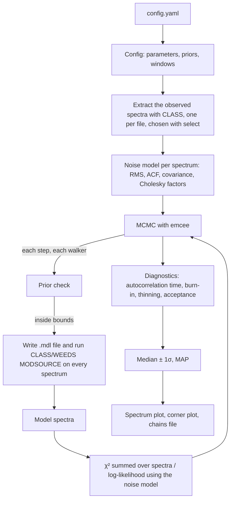

# mcWEEDS: methods and implementation notes

This document describes what mcWEEDS does, the choices it makes and their
limitations. Standard methods (generalised χ², Cholesky whitening, the emcee
sampler, autocorrelation times) are only named here, with references
([Section 15](#15-references)); the radiative-transfer model is that of WEEDS
(`MODSOURCE`; Maret et al. 2011 and the WEEDS manual). The limitations are collected
in [Section 14](#14-assumptions-and-limitations). Each section names the code that
implements it, e.g. `observation.py → build_window_whiteners`.

---

## Contents

0. [Overview](#0-overview)
1. [Parameters and priors](#1-parameters-and-priors)
2. [Extracting the observed spectrum](#2-extracting-the-observed-spectrum)
3. [The noise level (RMS)](#3-the-noise-level-rms)
4. [Correlated noise and the autocorrelation function](#4-correlated-noise-and-the-autocorrelation-function)
5. [Covariance matrix, Cholesky factorisation and whitening](#5-covariance-matrix-cholesky-factorisation-and-whitening)
6. [The other two chi-square methods](#6-the-other-two-chi-square-methods)
7. [Likelihood and posterior](#7-likelihood-and-posterior)
8. [Computing a model spectrum with CLASS/WEEDS](#8-computing-a-model-spectrum-with-classweeds)
9. [MCMC sampling with emcee](#9-mcmc-sampling-with-emcee)
10. [Convergence diagnostics, burn-in and thinning](#10-convergence-diagnostics-burn-in-and-thinning)
11. [Reported results: median, 1-sigma interval, MAP](#11-reported-results-median-1-sigma-interval-map)
12. [Outputs and plots](#12-outputs-and-plots)
13. [Fitting several spectra simultaneously](#13-fitting-several-spectra-simultaneously)
14. [Assumptions and limitations](#14-assumptions-and-limitations)
15. [References](#15-references)

---

## 0. Overview

mcWEEDS samples the posterior distribution of the LTE parameters (column density,
excitation temperature, source size, velocity offset, line width) of one to three
emission components (different species, or several components of one species),
given one or several observed spectra. The samples give medians, credible intervals,
correlations and degeneracies of the parameters.



The noise model depends only on the data and is computed once. Each likelihood
evaluation (one per walker and step) then runs CLASS/WEEDS once.

| Module | Responsibility |
|---|---|
| `config.py` | Reads the YAML file: spectra, selection, free, fixed and shared parameters and their bounds |
| `observation.py` | Extracts the spectra; estimates RMS and noise correlations; builds the whitening matrices |
| `class_model.py` | Writes and runs the CLASS/WEEDS macro for one parameter set, on all spectra |
| `fitting.py` | Prior, likelihood, the emcee run, diagnostics, saving the chains and results |
| `plotting.py` | Spectrum plot and corner plot |
| `run_mcweeds.py` | Runs the steps above in order |
| `tools/` | Single model without MCMC, plots of the observed lines, synthetic data, installation check, catalogue tools (not part of the fit) |

---

## 1. Parameters and priors

*Code: `config.py → Config._read_molecules`, `Config.expand`; `fitting.py → log_prior`*

### 1.1 The model parameters

Each component has the five parameters of a WEEDS model file:

| Parameter | Meaning | Unit |
|---|---|---|
| `ntot` | total column density $`N_\mathrm{tot}`$ | cm⁻² |
| `tex` | excitation temperature $`T_\mathrm{ex}`$ | K |
| `source_size` | source FWHM size $`\theta_s`$ | arcsec |
| `v_off` | velocity offset from the source velocity (VLSR) in the spectrum header | km s⁻¹ |
| `width` | line FWHM $`\Delta V`$ | km s⁻¹ |

- **`v_off`** equals the LSR velocity of the emission only if the velocity in the
  spectrum header is zero.
- **`width`** is the line width given to WEEDS. Optically thick lines appear broader
  than this, so it is not directly comparable with a Gaussian fit to an observed
  profile.

**The model.** For each component, WEEDS computes (WEEDS manual)

```math
T_B(\nu) = \eta\,\big[J_\nu(T_\mathrm{ex}) - J_\nu(T_\mathrm{bg}) - T_\mathrm{cont}\big]\,\big(1 - e^{-\tau(\nu)}\big),
\qquad
\eta = \frac{\theta_s^2}{\theta_s^2 + \theta_t^2},
```

with $`J_\nu(T) = (h\nu/k)/(e^{h\nu/kT} - 1)`$, $`T_\mathrm{bg}`$ the cosmic microwave
background (2.73 K), $`\tau(\nu)`$ the line opacity (summed over the lines of the
species), $`\eta`$ the beam dilution and $`\theta_t`$ the telescope beam. In WEEDS's
`modsource.py`, $`\theta_t = 1.22\,c/(\nu D)`$ with $`D`$ the `telescope_size`; for
interferometric data, an equivalent diameter $`D = 1.22\,c/(\nu\,\theta_\mathrm{beam})`$
reproduces a synthesised beam $`\theta_\mathrm{beam}`$.

- **Continuum.** mcWEEDS calls `MODSOURCE` without `/TCONT`, whose default is 0, so
  $`T_\mathrm{cont} = 0`$: the lines are modelled without a continuum source behind the
  gas.
- **Several components.** WEEDS computes the components separately and adds them.
  According to the WEEDS manual, this is not correct for spatially overlapping
  components with optically thick emission, whose line intensities are then
  overestimated. This applies to compact + extended components of one species with
  optically thick lines.

For column densities and LTE in general, see Mangum & Shirley (2015).

### 1.2 Free, fixed and shared parameters

Each parameter is one of:

- `[min, max]`: **free**, with a uniform prior between the bounds.
- `value` or `{fixed: value}`: **fixed**.
- `{shared_with: OTHER}`: **shared**: always equal to the same parameter of component
  `OTHER`, which must itself be free or fixed. This is one parameter constrained by the
  lines of both components, i.e. the assumption that they arise in the same gas.

`Config.expand(theta)` turns the vector of free parameters into the five values of
every component.

### 1.3 Column density fitted as $`\log_{10} N`$

The column density is sampled as $`\log_{10} N`$, with a uniform prior on
$`\log_{10} N`$ (a log-uniform prior on $`N`$). The bounds are given in linear units in
the YAML file. A uniform prior on $`N`$ itself would put most of the prior weight in
the highest decade (e.g. about 90 % above $`10^{15}`$ for bounds $`10^{13}`$–$`10^{16}`$
cm⁻²). Results are reported in linear units (Section 11).

### 1.4 Uniform (top-hat) priors

`log_prior` returns 0 inside the bounds of every free parameter and $`-\infty`$
outside. A posterior that piles up against a bound means that the data do not
constrain the parameter within that range; the reported interval then reflects the
bound.

### 1.5 Degeneracies

From the expression in Section 1.1:

- **Optically thin lines** ($`\tau \ll 1`$) with $`\theta_s \ll \theta_t`$: $`T_B`$ depends on
  $`N\,\theta_s^2`$, so column density and source size are degenerate.
- **Optically thick lines** ($`\tau \gg 1`$): $`T_B \to \eta\,[J_\nu(T_\mathrm{ex}) - J_\nu(T_\mathrm{bg})]`$,
  so source size and excitation temperature are degenerate.

The MCMC shows such degeneracies in the corner plot; it does not remove them.

---

## 2. Extracting the observed spectrum

*Code: `observation.py → init_observation`; `class_model.py → load_spectrum_commands`*

A CLASS macro is run once per spectrum:

```
file in <file>         ! a GILDAS VLM cube or a CLASS spectra file (.30m, .cla, ...)
set match 0.2          ! position-matching tolerance used by FIND
find /offset 0 0       ! select the spectrum (here: offset (0,0), the default)
say 'found'                                   ->  obs_found.txt
get f                  ! load the first spectrum found
set unit f             ! frequency axis
say 'frequency' / 'reference' / 'freq_step'  ->  obs_header.txt
say 'rx[i]' 'ry[i]' for every channel         ->  obs_spectrum.txt
```

The `select:` block of the config (global and/or per spectrum) sets the `FIND`
options:

| `select` key | CLASS | default |
|---|---|---|
| `offset: [x, y]` or `any` | `FIND /OFFSET x y` | `[0, 0]` |
| `match` | `SET MATCH` (offset tolerance, arcsec) | `0.2` |
| `number: n` or `[n1, n2]` | `FIND /NUMBER n1 n2` | – |
| `source`, `line`, `telescope` | `FIND /SOURCE`, `/LINE`, `/TELESCOPE` | – |

In a VLM cube every pixel is a spectrum at its offset, so offset (0, 0) is the
centre pixel. The same commands load the spectrum in every model run (Section 8),
so the model is always computed on the extracted spectrum. If no spectrum matches,
the run stops; if several match, a warning is printed and the first is used. See the
[CLASS documentation](https://iram.fr/IRAMFR/GILDAS/doc/html/class-html/class.html).

The frequency axis is rebuilt from the header,
$`\nu_i = \nu_0 + (i - i_\mathrm{ref})\,\delta\nu`$, where $`\nu_0`$ is the frequency of the
reference channel $`i_\mathrm{ref}`$ and $`\delta\nu`$ the channel spacing (with its sign).
The line windows (`line_windows`, the channels used in the fit) and noise windows
(`noise_windows`, line-free channels for the noise model) become channel masks with
strict inequalities, $`\nu_\mathrm{min} < \nu < \nu_\mathrm{max}`$. The spectrum is
passed from CLASS to Python as text.

---

## 3. The noise level (RMS)

*Code: `observation.py → init_observation`*

The RMS noise $`\sigma`$ of a spectrum is the standard deviation of all channels in
its noise windows, chosen by the user (automatic line-free detection is unreliable
in line-rich spectra). Alternatively, `noise_rms` fixes $`\sigma`$ (for all spectra or
per spectrum); the value measured in the noise windows is then still printed, and
still used to normalise the ACF estimate (Section 4). With both `noise_rms` and
`noise_acf` given, a spectrum needs no noise windows.

**Caveats.**

- The same $`\sigma`$ is assumed in the line windows as in the noise windows.
- Only the mean of all noise channels together is subtracted, so baseline offsets
  between noise windows increase $`\sigma`$.
- Weak lines in a noise window increase $`\sigma`$ and the measured correlation.
- With few noise channels $`\sigma`$ is uncertain (about $`1/\sqrt{2n}`$ relative for $`n`$
  independent channels). Since $`\chi^2 \propto 1/\sigma^2`$, an underestimated
  $`\sigma`$ gives that spectrum too much weight and too narrow a posterior. `noise_rms`
  measured on a larger line-free region avoids this.

---

## 4. Correlated noise and the autocorrelation function

*Code: `observation.py → segmented_acf`, `pooled_acf`, `truncate_acf`*

### 4.1 Why it matters

The noise of neighbouring channels is often correlated, e.g. after spectral
smoothing or regridding (see the
[ALMA Technical Handbook](https://almascience.org/proposing/technical-handbook) for
ALMA's spectral response). A χ² that treats correlated channels as independent
counts the same information several times: the posterior is too narrow, and
correlated noise features can be fitted as signal. The `whitened` likelihood
(Section 5) and the area error of `integrated` (Section 6) use the measured channel
correlation to avoid this.

### 4.2 The ACF estimate

The normalised autocorrelation function (ACF) $`\rho(k)`$ of the noise is estimated
from the noise windows, **within each contiguous run of noise channels**, so that
channels of different windows are never treated as neighbours. Each run's own mean
is subtracted, the lag products of all runs are summed, divided by the number of
pairs, and normalised by the value at lag 0:

```math
\hat\gamma(k) = \frac{\sum_s \sum_{i} (y_i - \bar y_s)(y_{i+k} - \bar y_s)}{\text{number of pairs } (i, i+k)},
\qquad
\hat\rho(k) = \frac{\hat\gamma(k)}{\hat\gamma(0)}, \qquad k = 0,\dots,49 .
```

Correlations beyond 49 channels are set to zero.

### 4.3 Truncation

For uncorrelated noise, the estimated $`\hat\rho(k)`$ at $`k > 0`$ scatters around zero
with a standard deviation of about $`1/\sqrt{N}`$ for $`N`$ noise channels (Bartlett 1946).
The ACF is therefore set to zero from the **first** lag where
$`|\hat\rho(k)| < 2/\sqrt{N}`$ onwards; $`N`$ is the total number of noise channels. The
number of remaining non-zero lags (including lag 0) is printed as the "effective
length"; a value of 1 means no significant correlation.

**Caveats.** At large lags there are fewer pairs than $`N`$, so the scatter is larger
than $`1/\sqrt{N}`$. A correlation that drops below the threshold and rises again
(e.g. a ripple) is cut at the first drop.

### 4.4 A fixed ACF (`noise_acf`)

`noise_acf: [1.0, ρ(1), ...]` (first value 1) replaces the estimate for all spectra,
e.g. with an ACF measured on a larger noise sample of the same data. This avoids a
noisy estimate from few noise channels, and its truncation to zero.

---

## 5. Covariance matrix, Cholesky factorisation and whitening

*Code: `observation.py → build_window_whiteners`; `fitting.py → log_likelihood` (`whitened`)*

With correlated Gaussian noise of covariance $`\mathbf C`$, the misfit is the
generalised χ², $`\chi^2 = \mathbf r^\mathsf{T}\mathbf C^{-1}\mathbf r`$ with residual
$`\mathbf r = \mathbf y - \mathbf m`$ (Hogg, Bovy & Lang 2010). mcWEEDS computes it as
follows:

- **Covariance.** Assuming stationary noise, $`C_{ij} = \sigma^2\rho(|i-j|)`$ (a Toeplitz
  matrix), built separately for each line window. Windows are treated as independent
  of each other, which holds when they are farther apart than the correlation length.
- **Positive-definiteness.** An estimated, truncated ACF is not necessarily a valid
  autocorrelation function. Before the fit, the smallest eigenvalue of the correlation
  matrix $`\rho(|i-j|)`$ of the largest line window is computed; if it is below
  $`-10^{-6}`$, the run stops with an error, and a fixed `noise_acf` (e.g. measured on a
  larger line-free region) or more noise channels are needed. For each window, if the
  smallest eigenvalue is $`\le 0`$ (rounding), eigenvalues below
  $`10^{-8}\lambda_\mathrm{max}`$ are raised to that value and $`\mathbf C`$ is rebuilt
  and symmetrised. A term $`10^{-8}\sigma^2`$ is always added to the diagonal. If the
  Cholesky factorisation still fails, the run stops with an error.
- **Whitening.** $`\mathbf C = \mathbf L\mathbf L^\mathsf{T}`$ (Cholesky, computed once
  per window). For each model, $`\mathbf L\mathbf z = \mathbf r`$ is solved by forward
  substitution and $`\chi^2 = \mathbf z^\mathsf{T}\mathbf z`$ (Rasmussen & Williams
  2006, Algorithm 2.1). The total χ² is the sum over the line windows.

**Caveats.**

- Overlapping line windows are counted twice in `whitened` mode; keep them disjoint.
- The term $`-\tfrac12\ln\det\mathbf C`$ of the Gaussian likelihood is omitted; it is
  constant because $`\mathbf C`$ does not depend on the parameters.

---

## 6. The other two chi-square methods

*Code: `fitting.py → _chi2_one_spectrum`*

- **`standard`:** $`\chi^2 = \sum_i (y_i - m_i)^2/\sigma^2`$ over the channels of the line
  windows (their union), assuming independent channels. With correlated noise it
  underestimates the uncertainties (Section 4.1).
- **`integrated`:** each line window is reduced to its integrated intensity,
  $`A_w = \Delta\nu\sum_{i\in w} y_i`$ (and likewise for the model), with error
  $`\sigma_{A,w} = \sigma\,\Delta\nu\,[\sum_{i,j\in w}\rho(|i-j|)]^{1/2}`$, where the sum runs
  over all pairs of the $`n_w`$ channels of the window and $`\rho`$ is the noise ACF
  (Section 4; for uncorrelated noise $`\sigma_{A,w} = \sigma\sqrt{n_w}\,\Delta\nu`$), and
  $`\chi^2 = \sum_w (A^\mathrm{obs}_w - A^\mathrm{mod}_w)^2/\sigma_{A,w}^2`$. It is insensitive to
  the line shape. With only one number per window, velocity and width are weakly
  constrained, and with fewer windows than free parameters (e.g. example 1: 4 line
  windows, 6 free parameters) the problem is under-determined.

---

## 7. Likelihood and posterior

*Code: `fitting.py → log_likelihood`, `log_probability`*

$`\ln\mathcal L = -\tfrac12\chi^2`$, summed over all spectra, and
$`\ln p(\boldsymbol\theta\mid\mathbf y) = \ln p(\boldsymbol\theta) + \ln\mathcal L`$ up to
a constant. The prior is checked first, so CLASS is not run outside the bounds.

**Failed models.** If CLASS fails, times out, or returns a spectrum of the wrong
length, $`\ln\mathcal L = -\infty`$. A failure is thus treated as if the data excluded
those parameters: failures concentrated in one region of parameter space bias the
posterior. CLASS failures and timeouts are written to `failed_models.log`; models that
fail all start-up retries (Section 8.3), return a spectrum of the wrong length, or raise a
Python error (printed in the terminal) are not.

---

## 8. Computing a model spectrum with CLASS/WEEDS

*Code: `class_model.py → write_model_file`, `build_model_macro`, `run_class_model`*

### 8.1 What happens for each model

1. The free parameters are converted into the five values per component
   (`Config.expand`).
2. The WEEDS model file is written, one line per component:
   ```
   ! species Ntot Tex source_size v_off width
   H2CO 5.000000e+14 75.0000 1.50000 12.0000 4.0000
   "SO, v=0" 3.000000e+15 70.0000 0.50000 12.0000 3.0000
   ```
   Species names containing a space or a comma (CDMS entries) are enclosed in double
   quotes; without them `MODSOURCE` stops with "E-MODSOURCE READMDL, Incorrect input".
   The values are written with enough digits that the likelihood changes smoothly
   with every parameter.
3. A CLASS macro loads the observed spectrum (with the selection of Section 2),
   selects the catalogue (`use in <catalog>`), runs
   `modsource <file> <telescope_size> /verbose` and `retrieve tb_model`, and writes
   the model channels to a text file; with several spectra this is repeated for each
   in the same CLASS run.
4. `class -nw @macro` runs as a separate process.

The model is computed on the channels of the observed spectrum, so no interpolation
is needed in Python. Within `MODSOURCE` (`modsource.py`), the spectrum is computed on
a finer frequency grid (one tenth of the smallest line width, or the channel width
if that is smaller) and resampled to the observed channels.

### 8.2 The spectroscopic catalogue

`catalog:` selects the line catalogue (frequencies, Einstein coefficients,
upper-level energies, partition functions): `cdms` or `jpl` for the online catalogues
(Maret et al. 2011; Müller et al. 2005; Endres et al. 2016; Pickett et al. 1998), or
a local copy made with CLASS (`use out <file>.db`, `select`, `insert`; see
`tools/make_catalog.class`). An online catalogue is queried for every model, which
is slow and depends on the server, and its content can change between runs; a local
copy avoids both. `tools/check_catalog.py` compares a local copy with the online
catalogue. The `species` of a component must be the catalogue's entry name (e.g.
`'SO, v=0'` in CDMS).

### 8.3 Parallel runs and retries

- **File names.** Each model uses a random unique identifier in its file names, so
  that parallel workers do not overwrite each other's files. The files are deleted
  after each model.
- **Start-up failures.** CLASS processes started at the same time can fail at start-up
  with an `F-MESSAGE_INIT` (or `errno`) message. mcWEEDS then waits until the
  next second plus a random 50–250 ms and retries, up to 10 times. A model that fails
  all 10 attempts counts as failed but is **not** written to `failed_models.log`.
- **Timeout.** Each CLASS run is allowed 60 s; a longer run is logged as a timeout
  and counted as failed.

Each model starts a new CLASS process; this start-up time dominates when
`MODSOURCE` itself is fast.

---

## 9. MCMC sampling with emcee

*Code: `fitting.py → initial_positions`, `run_mcmc`*

The posterior is sampled with **emcee** (Foreman-Mackey et al. 2013), the
affine-invariant ensemble sampler of Goodman & Weare (2010), with its default
stretch move. The sampler adapts to the scales and linear correlations of the
parameters, so no step sizes are tuned. For a practical introduction to MCMC, see
Hogg & Foreman-Mackey (2018).

- **Walkers.** emcee needs at least twice as many walkers as free parameters (see
  the emcee documentation).
- **Starting positions.** By default the walkers start uniformly over the prior
  box: nothing is assumed about the solution, but the burn-in is longer, and with
  wide bounds walkers can stay in low-probability regions for a long time. With
  `mcmc: init_model: <file>` the walkers start uniformly in a box around that model,
  of half-width `init_scatter` (default 0.05) times each prior range, clipped to the
  priors. This shortens the burn-in but can hide other modes; compare with a run
  started over the full priors when the posterior may be multimodal.
- **Parallelisation.** emcee updates the walkers in two halves; the
  $`n_\mathrm{walkers}/2`$ models of one half are computed in parallel by `n_threads`
  worker processes (`multiprocessing.Pool`). A step therefore takes about
  $`2\lceil (n_\mathrm{walkers}/2)/n_\mathrm{threads}\rceil`$ CLASS run times; `n_threads`
  should divide $`n_\mathrm{walkers}/2`$. `OMP_NUM_THREADS=1` is set so that the workers
  do not compete for cores in linear algebra.

---

## 10. Convergence diagnostics, burn-in and thinning

*Code: `fitting.py → summarize`*

- **Autocorrelation time.** τ is estimated per parameter with emcee's
  `get_autocorr_time(quiet=True)`, and the largest value, $`\tau_\mathrm{max}`$, is used
  (emcee documentation, autocorrelation tutorial). The code prints
  $`N_\mathrm{steps}/\tau_\mathrm{max}`$ and warns below 50, the length the emcee
  documentation recommends for a reliable τ; for shorter chains τ, and everything
  derived from it, is uncertain.
- **Burn-in:** $`\min(2\,\tau_\mathrm{max},\ 0.5\,N_\mathrm{steps})`$ steps are discarded.
- **Thinning:** every $`\max(1, \tau_\mathrm{max}/2)`$-th step is kept (integer part).
- **Fallback:** if τ cannot be estimated (error or NaN), the first 30 % of the steps
  are discarded and the chain is not thinned.
- **Acceptance fraction:** printed, with a warning outside 0.2–0.5 (Foreman-Mackey et
  al. 2013).
- **Number of samples:** the printed "effective independent samples" is the number
  of samples kept after burn-in and thinning. Since the thinning is $`\tau/2`$, it is
  about twice the number of independent samples. A warning is printed below 100.

---

## 11. Reported results: median, 1-sigma interval, MAP

*Code: `fitting.py → summarize`, `write_summary`*

### 11.1 Marginal median and 1σ interval

For each free parameter: value $`= P_{50}`$, $`+\sigma = P_{84} - P_{50}`$,
$`-\sigma = P_{50} - P_{16}`$, where $`P_q`$ is the $`q`$-th percentile of the kept samples.
These are marginal results (integrated over all other parameters) and allow
asymmetric errors. For a Gaussian distribution, $`P_{16}`$–$`P_{84}`$ is approximately
mean ± 1σ. Column densities are converted with $`N = 10^{P_{50}}`$,
$`+\sigma_N = 10^{P_{84}} - 10^{P_{50}}`$, $`-\sigma_N = 10^{P_{50}} - 10^{P_{16}}`$; percentiles
are unchanged by this monotonic transformation. Fixed and shared parameters are
listed separately.

**Statistical uncertainties only.** The intervals include only the noise of the
spectra. They do not include the flux-calibration uncertainty, which scales all
intensities together, nor the effect of fixed parameters such as an assumed source
size. Add these separately when quoting results.

### 11.2 MAP (maximum a posteriori)

The MAP is the kept sample with the highest posterior probability; with the
uniform priors used here, it is also the kept sample with the lowest χ². The
highest-probability point visited during burn-in, or removed by thinning, is not
considered.

### 11.3 Median versus MAP

The vector of marginal medians is not itself a sample and need not be a good fit
when parameters are correlated (e.g. a curved degeneracy). The MAP is a good fit but
does not describe the uncertainty. The spectrum plot shows both models; if they
differ strongly, inspect the corner plot.

---

## 12. Outputs and plots

*Code: `plotting.py`; `fitting.py → save_chains`, `save_best_fit`, `write_summary`*

All outputs are written to `MCMC_<run_name>/` (or `output_dir`):

- **`mcmc_best_fit_spectrum.png`:** observed spectrum (black), MAP model (red) and
  median model (blue, dashed); with several components, the MAP model of each
  component alone. With several spectra, one panel per spectrum, against velocity
  (radio convention) when the spectrum has a `rest_freq`, otherwise against
  frequency. Line windows are shaded; $`T_\mathrm{ex}`$ and $`N_\mathrm{tot}`$ of both
  models are listed. Transition markers (`transitions` in the YAML) are shifted with
  $`\nu = \nu_\mathrm{rest}(1 - v_\mathrm{sys}/c)`$ using `plot: v_sys`; they are for
  orientation only.
- **`mcmc_corner.png`** (corner.py; Foreman-Mackey 2016): marginal distributions of
  all free parameters, with the 16/50/84 % quantiles; medians in blue, MAP as red
  dotted lines.
- **`mcmc_chains.npz`:** `chain` (n_steps × n_walkers × n_free), `log_prob`
  (n_steps × n_walkers), `flat_samples` and `flat_log_prob` (after burn-in and
  thinning), `param_names`, `burnin`, `thin`. Column densities are stored as
  $`\log_{10} N`$.
- **`fit_summary.txt`:** median, ±1σ and MAP of every free parameter, with units;
  fixed and shared parameters; run settings.
- **`best_fit_spectrum.txt`** (`best_fit_spectrum_<i>.txt` with several spectra, in
  the order of the config): one row per channel with `freq_MHz`, `v_kms` (only with a
  `rest_freq`), `T_obs`, `T_MAP`, `T_median`, `T_MAP_<component>` (with several
  components) and `in_fit` (1 for channels in the line windows). The header gives the
  RMS used in the fit and the line windows. Read with `np.genfromtxt(path, names=True)`.
- **`map_model.yaml`, `median_model.yaml`:** the MAP and median parameters as model
  files, for `tools/single_model.py` (which also lists the line opacities) or as
  `init_model` of a new run.
- **`config_used.yaml`:** a copy of the configuration.
- **`failed_models.log`:** failed or timed-out models (only if there are any).
- **`obs_*.txt`, `init*.class`, `temp_mdl_files/`:** CLASS working files (the
  extracted spectrum, the number of matching spectra, the extraction macro, and the
  per-model files, which are deleted after each model).

---

## 13. Fitting several spectra simultaneously

*Code: `config.py → Config._read_spectrum`; `observation.py → init_observation`, `pooled_acf`; `class_model.py → build_model_macro`*

Lines of one species are often in separate spectra (e.g. single-line cut-outs);
lines with different upper-level energies constrain $`T_\mathrm{ex}`$, so they are
fitted together with one set of parameters.

- **One model, every spectrum.** For each parameter set, one WEEDS model file is
  evaluated on every spectrum in the same CLASS run. Each spectrum keeps its own
  frequency axis and resolution, and can have its own `telescope_size`.
- **Likelihood.** The total χ² is the sum over spectra, each with its own windows and
  noise model.
- **Noise.** The RMS is per spectrum (measured, or `noise_rms`). The ACF is pooled
  over all spectra with the same channel width, each spectrum's lag products divided
  by its own measured variance; for one spectrum this is the ACF of Section 4. A
  fixed `noise_acf` replaces the pooled estimate.

**Assumption.** Spectra with the same channel width have the same channel
correlation (unless `noise_acf` is given).

---

## 14. Assumptions and limitations

**Physics and model**

1. **LTE**, one excitation temperature per component (WEEDS `MODSOURCE`; Maret et al. 2011).
2. **Gaussian components** (source and line profile), up to three. Components are added without radiative coupling; for spatially overlapping components with optically thick lines this overestimates the line intensities (WEEDS manual; Section 1.1).
3. **Degeneracies:** column density with source size (optically thin), source size with $`T_\mathrm{ex}`$ (optically thick). The MCMC shows them; it does not remove them.
4. **No continuum:** $`T_\mathrm{cont} = 0`$ in `MODSOURCE` (Section 1.1).
5. **Catalogue:** an online catalogue is slow and can change between runs; a local copy avoids both.

**Noise model**

6. **Gaussian, stationary noise:** the same RMS and channel correlation in the line windows as in the noise windows.
7. **Clean noise windows:** truly line-free and representative.
8. **RMS:** only the global mean of the noise channels is subtracted, so baseline offsets between noise windows increase it.
9. **ACF:** at most 50 lags, truncated at the first lag consistent with zero ($`2/\sqrt{N}`$); periodic correlations (ripples) are not modelled.
10. **Line windows** are independent of each other (no cross-window covariance); overlapping windows are counted twice in `whitened` mode.
11. **`standard`** ignores channel correlations; **`integrated`** can be under-determined.

**Sampling and reporting**

12. **Failed models** count as zero probability; failures concentrated in one region bias the posterior (check `failed_models.log`).
13. **Start-up retries:** models that fail all 10 retries are not logged.
14. **Uniform priors:** results against a bound reflect the bound.
15. **Starting positions:** uniform over the priors (long burn-in) or around `init_model` (may miss other modes).
16. **Diagnostics:** τ, burn-in and thinning are estimates, unreliable for $`N_\mathrm{steps}/\tau < 50`$.
17. **MAP** is taken from the kept samples only.
18. **Sample count:** the printed number is about twice the number of independent samples.
19. **Median model:** the vector of marginal medians is not a posterior sample and may not fit well.
20. **Statistical uncertainties only:** flux calibration and fixed parameters (e.g. the source size) are not included (Section 11.1).

---

## 15. References

**WEEDS, GILDAS, catalogues and LTE**

- Maret, S., Hily-Blant, P., Pety, J., Bardeau, S., & Reynier, E. 2011, A&A 526, A47. [doi:10.1051/0004-6361/201015487](https://doi.org/10.1051/0004-6361/201015487)
- WEEDS manual: [HTML](https://iram.fr/IRAMFR/GILDAS/doc/html/weeds-html/node7.html) (the `MODSOURCE` model), [PDF](https://vizier.cfa.harvard.edu/doc/man/gildas/pdf/weeds.pdf)
- Gildas Team 2013, GILDAS: Grenoble Image and Line Data Analysis Software, Astrophysics Source Code Library, [ascl:1305.010](https://ascl.net/1305.010); <https://www.iram.fr/IRAMFR/GILDAS/>
- CLASS manual: [HTML](https://iram.fr/IRAMFR/GILDAS/doc/html/class-html/class.html)
- Müller, H. S. P., et al. 2005, J. Mol. Struct. 742, 215 (CDMS). [ADS](https://ui.adsabs.harvard.edu/abs/2005JMoSt.742..215M)
- Endres, C. P., Schlemmer, S., Schilke, P., Stutzki, J., & Müller, H. S. P. 2016, J. Mol. Spectrosc. 327, 95 (CDMS). [doi:10.1016/j.jms.2016.03.005](https://doi.org/10.1016/j.jms.2016.03.005)
- Pickett, H. M., et al. 1998, J. Quant. Spectrosc. Radiat. Transfer 60, 883 (JPL). [ADS](https://ui.adsabs.harvard.edu/abs/1998JQSRT..60..883P)
- Mangum, J. G., & Shirley, Y. L. 2015, PASP 127, 266. [doi:10.1086/680323](https://doi.org/10.1086/680323)

**MCMC and emcee**

- Foreman-Mackey, D., Hogg, D. W., Lang, D., & Goodman, J. 2013, PASP 125, 306. [doi:10.1086/670067](https://doi.org/10.1086/670067)
- Goodman, J., & Weare, J. 2010, Comm. App. Math. Comp. Sci. 5, 65. [doi:10.2140/camcos.2010.5.65](https://doi.org/10.2140/camcos.2010.5.65)
- emcee documentation: <https://emcee.readthedocs.io/>, in particular the [autocorrelation tutorial](https://emcee.readthedocs.io/en/stable/tutorials/autocorr/)
- Hogg, D. W., & Foreman-Mackey, D. 2018, ApJS 236, 11. [doi:10.3847/1538-4365/aab76e](https://doi.org/10.3847/1538-4365/aab76e)
- Foreman-Mackey, D. 2016, JOSS 1, 24 (corner.py). [doi:10.21105/joss.00024](https://doi.org/10.21105/joss.00024)

**Likelihoods and correlated noise**

- Hogg, D. W., Bovy, J., & Lang, D. 2010, Data analysis recipes: Fitting a model to data. [arXiv:1008.4686](https://arxiv.org/abs/1008.4686)
- Rasmussen, C. E., & Williams, C. K. I. 2006, Gaussian Processes for Machine Learning, MIT Press. <http://gaussianprocess.org/gpml/>
- Bartlett, M. S. 1946, J. R. Stat. Soc. Suppl. 8, 27.
